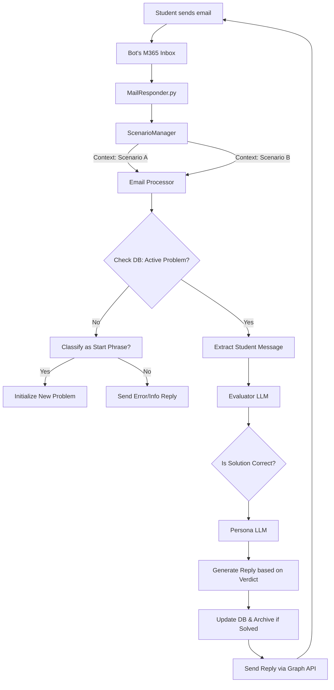

# MailResponder - Multi-Scenario AI Training Platform

MailResponder is an automated, AI-driven training platform designed to simulate realistic IT support and customer interaction conversations. It operates entirely over email, serving as a versatile environment for students to practice diagnostic, communication, and problem-solving skills across various scenarios.

The system is highly extensible, allowing for the creation of diverse "personas" and problem sets. Students progress through difficulty levels with automatic unlocks based on successful problem solving, while instructors can monitor progress via detailed analysis tools.

## Features

-   **Email-Based Interaction:** Communicates using the Microsoft Graph API to send and receive real emails.
-   **Multi-Scenario Architecture:** 
    - Supports multiple independent training scenarios simultaneously.
    - Each scenario has its own persona, problem set, and configuration.
    - **Custom Logic Hooks:** Scenarios can implement unique mechanics (like anger levels or timers) via a modular handler system.
    - Emails are dynamically routed to scenarios based on the target mailbox.
-   **Progressive Learning System:** Configurable difficulty levels (e.g., L1-L5) per scenario with automatic progression.
-   **Dynamic Persona Simulation:** Personas respond in character, localized to specific languages (e.g., Swedish) and communication patterns.
-   **Isolated Databases per Scenario:**
    - **Progress Tracking:** Tracks student progress and active conversations.
    - **Conversation Archiving:** Saves completed conversations to an archive.
    - **Debug Logging:** Full AI conversation histories and evaluator responses for analysis.
-   **Advanced Email Processing:**
    - Intelligent reply detection and conversation threading.
    - Email content cleaning and HTML parsing.
    - **Image Detection:** Automatically detects attachments and inline/copy-pasted images.
    - **Accessibility Warning:** Prepends configurable warnings to persona replies if images are detected.
-   **Dual-LLM Orchestration:**
    -   **Evaluator AI:** A logical model (e.g., gemma3) that determines if solutions correctly solve problems.
    -   **Persona AI:** A creative model that simulates the scenario's persona, aware of the evaluator's verdict and conversation context.
-   **Multi-User & Race Condition Prevention:** Handles multiple students simultaneously with robust concurrency management.
-   **Analysis Tools:** Comprehensive debugging via the `db_inspector.py` utility.

## How It Works

The system operates in a background loop, continuously checking one or more email inboxes defined in the active scenarios. When a message is received, the `ScenarioManager` routes it to the correct context, triggering the following lifecycle:



1.  **Scenario Discovery:** `ScenarioManager` loads all enabled scenarios from the `scenarios/` directory.
2.  **Email Polling:** `MailResponder.py` iterates through scenarios and fetches unread emails for each configured mailbox.
3.  **Contextual Processing:** `email_processor.py` filters noise and classifies the action (Start Problem vs. Continue Conversation).
4.  **Evaluation:** `evaluator.py` uses an LLM to judge the student's message against the problem's solution criteria.
5.  **Persona Generation:** `response_generator.py` creates a character-appropriate response based on the evaluation outcome.
6.  **Persistence:** Conversation history and progress are updated in the scenario-specific SQLite databases.

## Setup and Installation

### Prerequisites

-   Python 3.8+
-   An active [Ollama](https://ollama.com/) instance, running and accessible from where the script is hosted.
-   The LLM models specified in your `.env` file must be pulled in Ollama (e.g., `ollama pull gemma3:12b-it-qat`).
-   An Azure Active Directory (Azure AD) account with permissions to create and manage App Registrations.

### Step 1: Clone the Repository

```bash
git clone <your-repository-url>
cd <your-repository-directory>
```

### Step 2: Create and Activate Virtual Environment

It is critical to use a virtual environment to isolate project dependencies.

1.  **Create the environment:**
    ```bash
    python -m venv .venv
    ```

2.  **Activate the environment:**
    -   On **Windows** (PowerShell/CMD):
        ```bash
        .\.venv\Scripts\activate
        ```
    -   On **Linux / macOS**:
        ```bash
        source .venv/bin/activate
        ```
    Your command prompt should now be prefixed with `(.venv)`.

### Step 3: Install Python Dependencies

With the virtual environment active, install the required libraries from `requirements.txt`.

```bash
pip install -r requirements.txt
```

### Step 4: Azure App Registration

This bot requires access to a mailbox via the Microsoft Graph API. This is the most critical part of the setup.

1.  Go to the [Azure Portal](https://portal.azure.com/) and navigate to **Microsoft Entra ID** > **App registrations**.
2.  Click **New registration**.
3.  Give it a name (e.g., "UllaSupportBot").
4.  Under "Supported account types," select "Accounts in this organizational directory only."
5.  Click **Register**.
6.  **Save the following values** from the "Overview" page for your `.env` file:
    -   `Application (client) ID`
    -   `Directory (tenant) ID`
7.  Go to **Certificates & secrets** > **New client secret**.
8.  Add a description and set an expiry.
9.  **Immediately copy the `Value` of the new secret.** This is your only chance to see it.
10. Go to **API permissions** > **Add a permission**.
11. Select **Microsoft Graph**.
12. Select **Application permissions** (NOT Delegated permissions).
13. Add the following permissions:
    -   `Mail.ReadWrite`
    -   `Mail.Send`
14. Click **Add permissions**.
15. **Crucially**, grant admin consent by clicking the **Grant admin consent for [Your Tenant]** button and confirming. The status for the permissions must change to "Granted".

### Step 5: Configure Scenario Environment Variables

All configuration is **per-scenario**. Each scenario folder under `scenarios/` gets its own `.env` file with the credentials for that scenario's target mailbox. There is no global `.env` — the `example.env` in the repository root is a reference template only.

1.  Create a file named `.env` **inside the specific scenario directory** (e.g. `scenarios/ulla_support/.env`).
2.  Copy the contents of `example.env` from the repository root and fill in the credentials matching that scenario's mailbox.

```dotenv
# --- Azure AD App Registration Credentials ---
AZURE_CLIENT_ID="<Your-Application-Client-ID-from-Azure>"
AZURE_TENANT_ID="<Your-Directory-Tenant-ID-from-Azure>"
AZURE_CLIENT_SECRET="<Your-Client-Secret-Value-from-Azure>"

# --- Target Mailbox (Scenario Specific) ---
BOT_EMAIL_ADDRESS="persona.name@yourdomain.com"

# --- LLM Model Configuration ---
PERSONA_MODEL="gemma3:12b-it-qat"
EVAL_MODEL="gemma3:12b-it-qat"

# --- Optional: Specify Ollama host if not running on localhost ---
# OLLAMA_HOST="http://192.168.1.100:11434"
```

> [!NOTE]
> Each scenario's `.env` or `config.json` values take precedence over any system-level environment variables. Models and the Ollama host URL can differ between scenarios.

## Usage

### Running the Bot

Before running the bot manually, make sure the virtual environment is active. You'll know it's active when your terminal prompt is prefixed with `(.venv)`.

-   **Windows** (PowerShell):
    ```powershell
    .\.venv\Scripts\activate
    ```
-   **Linux / macOS**:
    ```bash
    source .venv/bin/activate
    ```

#### Running in the Foreground
To run the bot and see live log output in your terminal, simply execute the script:
```bash
python MailResponder.py
```
This is recommended for testing and debugging. The script will stop if you close the terminal or press `Ctrl+C`.

#### Running as a System Service (Linux — Recommended for Production)

For reliable, always-on operation on a Linux server, register the bot as a `systemd` service. This ensures it starts automatically on boot and restarts itself if it crashes.

1.  Create a service file (replace the paths and user to match your server):
    ```bash
    sudo nano /etc/systemd/system/mailresponder.service
    ```
    ```ini
    [Unit]
    Description=MailResponder AI Training Bot
    After=network.target

    [Service]
    User=<your-linux-user>
    WorkingDirectory=/path/to/MailResponder
    ExecStart=/path/to/MailResponder/.venv/bin/python MailResponder.py
    Restart=on-failure
    RestartSec=10

    [Install]
    WantedBy=multi-user.target
    ```

2.  Enable and start the service:
    ```bash
    sudo systemctl daemon-reload
    sudo systemctl enable mailresponder
    sudo systemctl start mailresponder
    ```

3.  Check that it's running:
    ```bash
    sudo systemctl status mailresponder
    ```

4.  View live logs:
    ```bash
    journalctl -u mailresponder -f
    ```

### Monitoring Student Progress (`db_inspector.py`)

`db_inspector.py` is the main tool for checking how students are doing and for reviewing the AI's behavior. It reads directly from the scenario databases and prints a summary to the terminal. You do **not** need programming knowledge to use it — just run the commands below from the project directory with the virtual environment active.

**Quick start — see everything:**
```bash
python db_inspector.py
```
Prints a summary of all scenarios: which students are active, what level they're on, and how far they've progressed.

**Look up a specific student:**
```bash
python db_inspector.py -e student@example.com
```
Filters all output to only show that student's conversations and progress.

**See the full AI conversation logs:**
```bash
python db_inspector.py --debug
```
Shows the raw back-and-forth between the system and the AI models, including evaluator verdicts. Useful for understanding *why* the bot responded a certain way.

**Search conversation history for a keyword:**
```bash
python db_inspector.py --search "hårddisk"
```
Searches across all stored conversations for a specific word or phrase (supports Swedish characters).

**List all loaded scenarios:**
```bash
python db_inspector.py --list
```
Shows the names and database file paths of all currently active scenarios. Handy for confirming everything loaded correctly.

## Testing

MailResponder includes a comprehensive, isolated test suite that runs without requiring an internet connection or live LLM access (via extensive mocking).

### Running Tests
To run all unit tests and verification scripts, use the central test runner:

```bash
python tests/run_all.py
```

The suite covers:
- **Core Simulation**: Integration of email processing and LLM orchestration.
- **Scenario Logic**: Testing state tracking and fail states (e.g., Arga Alex).
- **Database**: Stability of student progress and history persistence.
- **Email Parsing**: Reliability of reply detection and HTML cleaning.
- **Verification**: Idempotency and prompt structure integrity.

## Project Structure

```
.
├── MailResponder.py          # Main application entry point (background loop)
├── scenario_handlers.py      # Extension: Modular hooks for scenario-specific logic
├── scenario_manager.py       # Core: Manages discovery and loading of scenarios
├── email_processor.py        # Orchestration: Routes emails to the correct scenario context
├── conversation_manager.py   # Logic: Manages conversation flow and state transitions
├── response_generator.py     # AI: Generates persona-specific replies
├── evaluator.py              # AI: Logic for judging student solutions
├── email_parser.py           # Utility: Extracts clean text (persona-agnostic)
├── database.py               # Data: SQLite operations and schema management
├── db_inspector.py           # Tools: CLI for monitoring progress
├── graph_api.py              # API: Microsoft Graph integration
├── config.py                 # Config: Central environment management
├── llm_client.py             # Client: Ollama API integration wrapper
├── scenarios/                # Directory containing specific training scenarios
│   ├── ulla_support/         # Classic tech support simulation (Ulla persona)
│   ├── arga_alex/            # Anger de-escalation simulation (Alex persona)
│   └── bengt_support/        # Precision guidance simulation (Bengt persona)
│       ├── config.json       # Scenario metadata, email, and model selection
│       ├── problems.json     # Catalog of problems, start phrases, and solution keys
│       ├── persona_prompt.txt # System prompt defining the persona's character
│       ├── evaluator_prompt.txt # System prompt defining evaluation rules
│       ├── .env              # Scenario-specific secrets (M365 credentials, etc.)
│       └── [prefix]_conversations.db # Auto-generated databases for this scenario
├── tests/                    # Comprehensive test suite and verification scripts
│   └── run_all.py            # Central test runner
├── requirements.txt          # Python dependencies
└── example.env               # Template for per-scenario .env files
```

## Configuration and Extension

The system is designed to be extended by adding new scenario folders to the `scenarios/` directory. Each folder is a self-contained training module.

### 1. Create Scenario Configuration (`config.json`)
Define the scenario's behavior, target mailbox, and specific LLM models:
```json
{
  "scenario_name": "Technical Support",
  "persona_name": "Kim",
  "description": "A short description of this scenario.",
  "db_prefix": "tech_support",
  "target_email_env_var": "BOT_EMAIL_ADDRESS",
  "persona_model": "gemma3:12b",
  "eval_model": "gemma3:12b",
  "image_warning_message": "Kim confirms they cannot see images."
}
```

> [!NOTE]
> Use `target_email_env_var` to read the mailbox address from the scenario's `.env` file (recommended). Alternatively, you can hardcode the address directly with `"target_email": "kim.support@domain.com"`. Set `"enabled": false` to temporarily disable a scenario without removing its folder.

### 2. Define Problems (`problems.json`)
Structure your training into levels. Each level is unlocked when a problem from the previous level is solved:
- **`start_phrases`**: An array of phrases that students email to start a specific level.
- **`catalog`**: An array of levels, each containing a list of potential problems.

### 3. Author Prompts
- **`persona_prompt.txt`**: Define the character, tone, and communication style.
- **`evaluator_prompt.txt`**: Define the criteria for a "solved" problem. The evaluator should output `[LÖST]` when the student provides the correct solution.

### 4. Advanced: Custom Logic (Handlers)
For scenarios requiring complex state tracking, you can implement a custom handler in `scenario_handlers.py` by subclassing `BaseScenarioHandler` and registering it in `HANDLER_REGISTRY`. The system calls these hooks at specific points in the email lifecycle:
- `on_start_problem`: Initialize scenario-specific state.
- `modify_start_email_body`: Modify the opening email sent to the student.
- `get_eval_history_context`: Control how much conversation history the evaluator sees.
- `on_evaluator_result`: React to the evaluator's verdict (e.g., adjust a state counter).
- `is_problem_solved`: Override the solver verdict based on custom state (e.g., reject if anger > 10).
- `check_failure_state`: Terminate the session if failure conditions are met.
- `modify_persona_context`: Inject state information into the persona AI's prompt.
- `modify_persona_reply`: Post-process the persona's reply before sending (e.g., append a status tag).

Two handlers ship with the project:
- **`ArgaAlexHandler`**: Tracks an anger level (0–200). Anger rises and falls based on the evaluator's score adjustment. The problem is only considered solved when anger has dropped below 10, and the session fails if anger reaches 200.
- **`BengtHandler`**: Tracks a stress level that rises passively every turn regardless of student performance. The student must give Bengt clear enough instructions to "reveal" the target value (a weighted probability roll that worsens as stress increases), and the session fails if stress exceeds the threshold.
